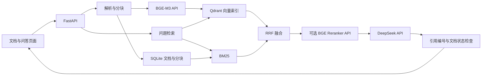

# 知源 RAG 系统设计

## 核心技术

Python 3.12、FastAPI、兼容 Chat Completions 的 DeepSeek LLM API、硅基流动 BGE-M3 Embedding、Qdrant 向量数据库、SQLite 元数据与运行轨迹。前端为原生 JavaScript，Markdown 使用本地打包的 marked 与 DOMPurify。

纯向量和 BM25 路径可独立运行；混合检索可跳过重排。生成草稿通过 SSE 返回，最后结果通过编号校验，不能据此声称所有事实都经过语义验证。

## 数据一致性

- 文档以 filename + version 唯一约束区分版本；相同内容哈希可直接去重。
- 只有 ready 文档进入检索；失败导入的向量即使残留也不对用户可见，可以经删除接口清理。
- 删除先将文档设为 deleting，再清理向量与元数据；模型生成后再检查来源是否仍存在。
- Embedding 配置指纹隔离向量空间，模型或维度变更要求重新建库。

## 可复现评测

独立 data/benchmark-fastapi 数据目录；固定官方文档 commit 和文件校验和；dev/test 按来源文档分组；原始结果记录每题每种检索方案的片段、排名及端到端检索耗时。与交互演示数据分开。

## 已知边界

单进程、小语料、无租户认证；BM25 查询时重建；没有持久化后台任务队列；召回阈值未做独立校准。模型请求已有连接/读取超时与有限退避重试，尚无熔断；流式中断不重放，细节见 DEPLOYMENT.md。文档固定字符切分可能截断语义或代码块，后续应在新的开发集上比较章节切分，冻结配置后再评估新测试集。
